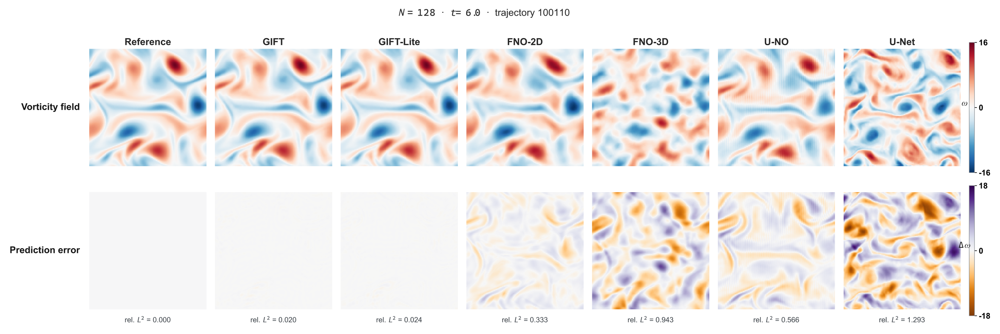
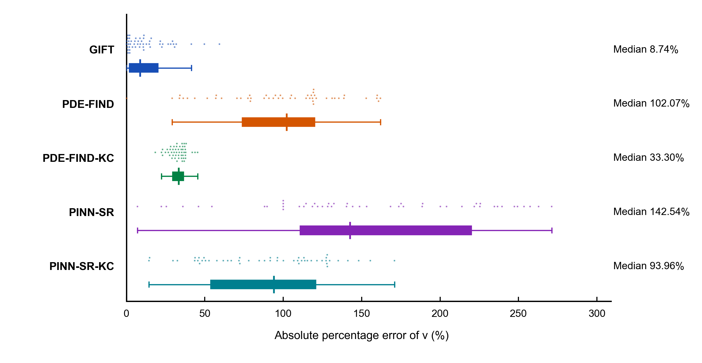
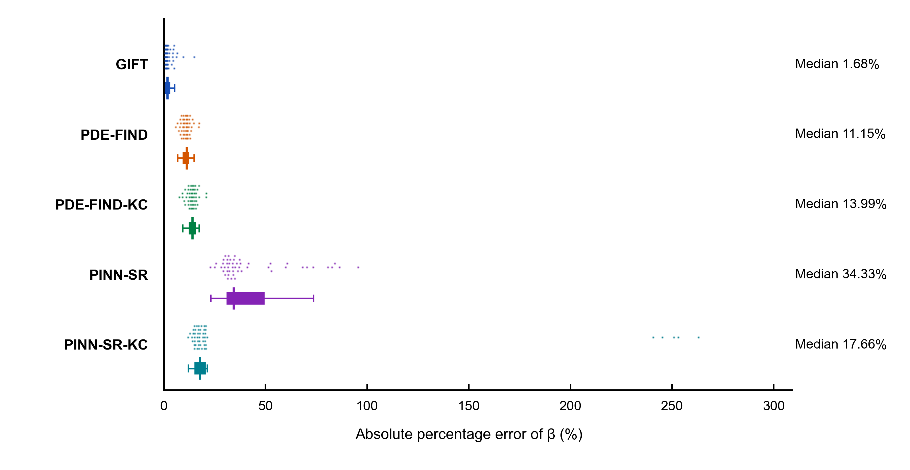
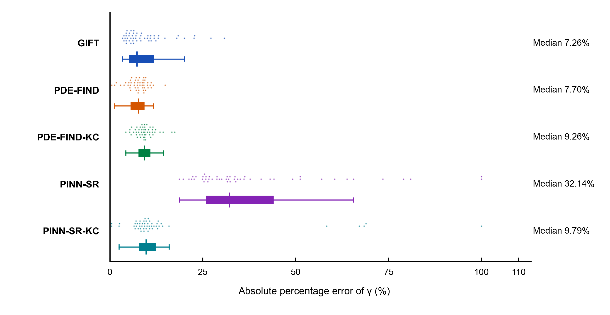
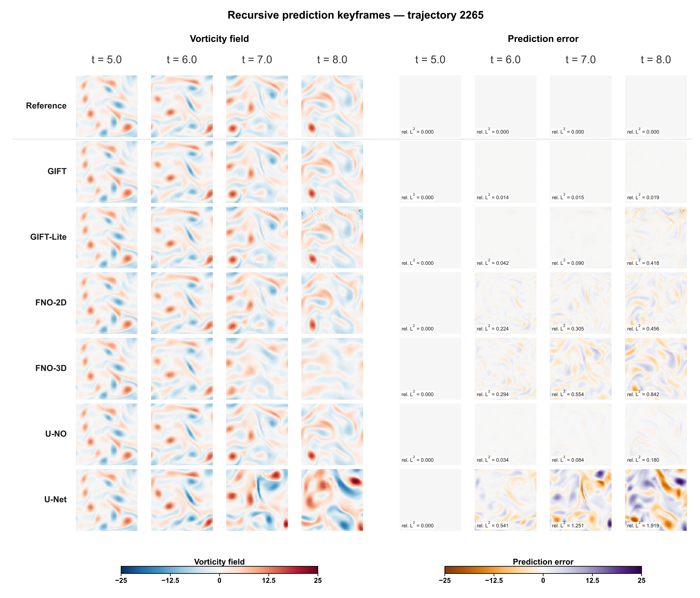

# GIFT 数值实验记录

本记录按论文顺序报告流场演化预测、跨分辨率预测、方程参数识别及三项辅助实验的方法、数据与测量结果。

W1比较GIFT、FNO-2D、FNO-3D、U-NO、U-Net、ANIE，以及减少训练样本和更新预算的GIFT-Lite。W2比较其中除ANIE外的六种方法。W1/W2的主方法使用300条训练轨迹、20条验证轨迹、单个真实初始状态，以及$t=5$至$8$、间隔0.04秒的76点观测网格；超参数预先固定，每方法训练一次。

W1/W2分别以未来75/25个节点的逐帧相对$L^2$均值为主指标，另报终点误差、MSE和失败数。两个评价集各含180条轨迹，与训练和验证集互不重叠。两个评价人口的结果均已被查看，因此不作为盲测；另一测试集用于探索性评价。W3采用单轨迹参数识别协议，S1–S3采用独立的N1000辅助实验协议；各实验的训练规模和统计范围分别说明。

## 1. 实验总表

实验编号、名称与排列顺序采用论文手稿的 W1、W2、W3、S1、S2、S3。代码模块、运行入口与数值清单统一使用该编号；定义见 [实验命名](docs/EXPERIMENT_NOMENCLATURE.md)。

| 编号 | 类别 | 实验名称 | 目的 | 比较对象 | 运行入口 | 结果目录 |
| --- | --- | --- | --- | --- | --- | --- |
| W1 | 主线实验 | 流场演化预测 | N64、t5–8、future75及失败 | GIFT、GIFT-Lite、FNO-2D、FNO-3D、U-NO、U-Net、ANIE | `experiments/additional/w1_current_evaluate.py` | `results/formal/W1_flow_prediction_20261007/` |
| W2 | 主线实验 | 原生跨分辨率预测 | N64训练直接N64/N96/N128、t5–6、future25 | GIFT、GIFT-Lite、FNO-2D、FNO-3D、U-NO、U-Net；无ANIE | `experiments/additional/w2_single_evaluate.py` | `results/formal/W2_cross_resolution_20261007/` |
| W3 | 主线实验 | 方程参数识别 | 无噪声下50组参数、每组一条ID0轨迹，各方法逐组识别 | GIFT、PINN-SR、PDE-FIND、PINN-SR-KC、PDE-FIND-KC | `scripts/run_w3_parameter_job.py`，按参数case独立执行 | [W3 50组无噪声结果](results/formal/W3_single_trajectory_20261010/) |
| S1 | 辅助实验 | 高频支路有效性 | 评价高频支路对瞬时方程右端和递归状态的整体作用 | GIFT、GIFT-Lite 及各自的高频支路关闭配置 | `experiments/formal/s1_high_frequency_branch/run.py` | `results/formal/S1_high_frequency_branch/` |
| S2 | 辅助实验 | 递归局部修正有效性 | 评价递归局部修正对非有限结果和局部误差放大的抑制作用 | GIFT、GIFT-Lite 及各自的递归局部修正关闭配置 | `experiments/formal/s2_recursive_local_correction/run.py` | `results/formal/S2_recursive_local_correction/` |
| S3 | 辅助实验 | 初值分布对照 | 四涡旋与高斯初值各自训练及测试的分布内比较 | GIFT、GIFT-Lite、FNO-2D、FNO-3D、U-NO、U-Net | `experiments/formal/s3_initial_distribution/run.py` | `results/formal/S3_initial_distribution/` |

## 2. 研究对象、数据和统一设置

### 2.1 频率分解

设 $\widehat{\omega}(k_x,k_y)$ 为状态 $\omega$ 的二维 Fourier 系数。方形投影 $P_m$ 定义为

$$
\widehat{P_m \omega}(k_x,k_y)=
\begin{cases}
\widehat{\omega}(k_x,k_y), & |k_x|\le m\ \text{且}\ |k_y|\le m,\\
0, & \text{其他情况}.
\end{cases}
$$

$Q_{21}$ 是 $P_{21}$ 的补空间投影，因此

$$
Q_{21}\omega=\omega-P_{21}\omega,\qquad
\omega_K=P_{21}\omega,\qquad
\omega_Q=Q_{21}\omega,\qquad
\omega=\omega_K+\omega_Q.
$$

$\omega_K$ 是带限状态，$\omega_Q$ 是补状态；$Q_{21}$ 包含 $P_{21}$ 之外的全部可表示模态。本记录不把 $Q_{21}$ 再划分为更窄的频段来评价高频支路的作用。注意符号 $Q$ 表示生成元的二次通道，$Q_{21}$ 表示谱投影，两者互不相关，全文不混用。

### 2.2 W1/W2训练数据、超参数与成本

本节GIFT-Lite指N300训练名单的50样本配置，原始数值和权重的来源键为`GIFT-N50`。它与S1–S3独立N1000协议中的同名配置分别声明，不能互换权重；当前样本比例为50/300。

主方法只读取N64原涡量训练池中由 `default_rng(2026100304).permutation(1000)[:300]` 固定选出的300条；GIFT-Lite使用该有序名单前50条，原IDs1000–1019验证20条。观测为t5–8每0.04秒76真实点，从原dt0.02帧250,252,…,400精抽；训练和测试输入均只有各轨迹自己的t5真场。所有normalizer和尺度由声明训练观测拟合，不读test统计。

| 方法 | Ntrain | seed | 阶段/epoch、物理batch | optimizer/lr与选择 | 实际训练目标 |
| --- | ---: | --- | --- | --- | --- |
| GIFT | 300 | generator2026072301/branch20260820 | generator250+250，batch16；branch400/50/25/25，batch16/5 | 分阶段AdamW及学习率日程；终态 | 全窗口coarse FD及局部RK4；监督滞后.08/.48秒 |
| GIFT-Lite | 50 | 同GIFT各组件seed | 同阶段epoch与batch | 同配方，终态 | 同目标形式，样本及总更新少于N300 |
| FNO-2D | 300 | 0 | 500，batch20 | Adam lr.001/wd1e-4，StepLR100×.5；终态 | t5闭环课程[1,2,5,10,25,50,75]；121轮起完整75步 |
| FNO-3D | 300 | 0 | 500，batch10 | Adam lr.001/wd1e-4，StepLR100×.5；终态 | 一次输出75未来点，时空relative L2 batch-sum |
| U-NO | 300 | 0 | 500，batch16，尾12保留 | 原UNO Adam lr.001/wd1e-5，每epoch StepLR100×.5；终态 | t5闭环20步，只监督t5.04–5.80 |
| U-Net | 300 | 0 | 500，batch20 | Adam lr.001/wd1e-4，StepLR100×.5；终态 | t5闭环4步，只监督t5.04–5.16 |
| ANIE | 300 | 7 | 上限5000，actual1029；effective32/micro6 | 原NS Adam lr1e-4/wd1e-4、延迟CosineT101；原MSE-best第29轮 | 全76点原单位MSE，含初態重建，patience1000原早停 |

FNO-2D、U-NO和U-Net的相对$L^2$损失按batch与监督时刻求和；FNO-3D在展平的未来时空场上计算相对$L^2$并对batch求和；ANIE使用全76点的MSE。ANIE按space-major/time-minor顺序组织状态与时空坐标，同一token的场特征和(x,y,t)严格对应；训练与评价使用相同排列。各方法保留其声明的原生目标。U-NO采用20步监督、每epoch推进调度器和终态权重，与作者示例的40步监督及validation-best设置不同。U-Net使用公开网络及项目训练配方。因此本实验比较预先固定的训练方法，不是各论文完整实验的复现。算法来源和必要接口适配见 [外部适配说明](docs/EXTERNAL_ADAPTATIONS.md)。

GIFT使用内部dt=0.02秒，共150个RK4积分步，每2步保存到0.04秒观测网格；coarse FD只读取76个真实节点。局部监督的0.08/0.48秒滞后由观测节点就近选择，对应名义0.1/0.5秒监督目标。N300生成元/分支分别执行9500/13600次更新，GIFT-Lite为2000/2600次。GIFT-Lite同时减少数据量和总优化预算，不能把差异唯一归因于样本量。

| 方法 | 训练进程耗时（秒） | 小时 |
| --- | ---: | ---: |
| GIFT | 10296.856 | 2.8602 |
| FNO-2D | 5482.334 | 1.5229 |
| FNO-3D | 6104.994 | 1.6958 |
| ANIE | 21176.742 | 5.8824 |
| U-NO | 8332.408 | 2.3146 |
| U-Net | 652.677 | 0.1813 |
| GIFT-Lite | 1911.591 | 0.5310 |

耗时为训练进程墙钟时间，包括数据准备、训练、验证、检查点I/O和导出；GIFT包含生成元和高频支路两个组件。计算设备为RTX A5500 Laptop GPU。各方法的监督覆盖、更新次数和模型选择规则不同，以上成本与精度共同描述固定训练配方的表现，不构成等计算预算的架构比较。

## 3. 方法

### 3.1 冻结生成元与高频支路

训练结束后，生成元保持冻结。在每个 Runge–Kutta 子步，带限方程右端为

$$
g_L(\omega)=P_{21}\!\left(G_{\mathrm{frozen}}(\omega)\right).
$$

高频支路同时读取完整状态、补频带状态 $h=\omega_Q$ 和冻结生成元的输出：

$$
x_{\mathrm{branch}}(\omega)=
\left[
\frac{\omega}{s_\omega},\ \frac{h}{s_h},\ \frac{g_L(\omega)}{s_G}
\right].
$$

所有输入尺度由训练观测计算并随模型保存。W1/W2所用高频支路的尺度为：

| 尺度 | GIFT N300 | GIFT-Lite |
| --- | ---: | ---: |
| $s_\omega$ | 4.215759754180908 | 4.2226972579956055 |
| $s_h$ | 0.11572107672691345 | 0.11324163526296616 |
| $s_G$ | 10.980302810668945 | 11.309041976928711 |
| $s_H$ | 1.3984959125518799 | 1.3940997123718262 |

生成元自身的状态尺度分别为4.25614856811639与4.230389636607154，独立于上表的高频支路输入尺度。生成元两个阶段各250轮，学习率按每次优化器更新作余弦衰减：第一阶段0.01至0.0002，第二阶段0.003至0.00006。

三个输入通道先经过逐点映射，再进入宽度 20、包含四个谱卷积层的主干网络。输出映射层给出增长、两个方向的输运、扩散和源项系数。高频方程右端为

$$
\begin{aligned}
g_H(\omega)=Q_{21}\Bigg\{
&s_H\left(
a\frac{h}{s_h}
+v_x\frac{\partial_x h}{32s_h}
+v_y\frac{\partial_y h}{32s_h}
+\kappa\frac{\Delta h}{32^2s_h}
\right)\\
&+b_{\mathrm{source}}(\omega)
\Bigg\}.
\end{aligned}
$$

增长和输运系数使用双曲正切约束，扩散系数使用 sigmoid 约束。状态相关项作用于全部补频带状态 $\omega_Q$，输出再投影到 $Q_{21}$。高频支路没有预先设定的最高输出模态；在给定网格上，可表示的最高频率由该网格的 Nyquist 频率决定。因此，跨分辨率实验评价的是模型在所测试离散网格上的直接适用性，不表示可以恢复无限高的频率。

带限状态和补频带状态在同一 RK4 积分中耦合推进：

$$
\frac{\mathrm{d}\omega_K}{\mathrm{d}t}=g_L(\omega),
\qquad
\frac{\mathrm{d}\omega_Q}{\mathrm{d}t}=g_H(\omega).
$$

### 3.2 递归局部修正

递归局部修正在每个完整 RK4 步之后执行。对 $B\in\{P_{21},Q_{21}\}$ 分别计算

$$
\begin{aligned}
u_B&=B(\omega),\\
c_B&=u_B-\operatorname{mean}(u_B),\\
\sigma_B&=\max\!\left(\sqrt{\operatorname{mean}(c_B^2)},\epsilon_{32}\right),\\
m_B(x)&=\operatorname{median}\!\left\{c_B(y):y\in\mathcal{N}_{5\times5}(x),\ y\ne x\right\},\\
r_B&=c_B-m_B,\\
\ell_B&=2.1\sigma_B,
\end{aligned}
$$

其中 $\epsilon_{32}$ 是 float32 的最小正正规数，$\mathcal{N}_{5\times5}(x)$ 是以 $x$ 为中心的周期邻域。

若局部残差和中心幅值同时超过阈值，则把残差裁剪到允许范围。设频带 $B$ 的幅值阈值为 $A_B$，则

$$
\widetilde{\delta}_B(x)=
\begin{cases}
\operatorname{clip}\!\left(r_B(x),-\ell_B,\ell_B\right)-r_B(x),
& |r_B(x)|>\ell_B\ \text{且}\ |c_B(x)|>A_B,\\
0, & \text{其他情况},
\end{cases}
$$

$$
\delta_B=B\widetilde{\delta}_B-\operatorname{mean}\!\left(B\widetilde{\delta}_B\right),
\qquad
\omega_{n+1}=P_{21}\omega+\delta_{P_{21}}+Q_{21}\omega+\delta_{Q_{21}}.
$$

$P_{21}$ 的幅值阈值为 22，$Q_{21}$ 的幅值阈值为 12。$P_{21}$ 和 $Q_{21}$ 的异常检测、触发计数和安全上限判定相互独立。每个频带在单条轨迹、单个积分步中允许的异常网格点上限为

$$
K_N=\max\!\left(1,\left\lfloor\frac{40N^2}{4096}\right\rfloor\right).
$$

$N=64$、$N=96$ 和 $N=128$ 时，$K_N$ 分别为 40、90 和 160。若任一频带的异常点数超过相应上限，该频带不执行修正，并终止该轨迹的后续积分；运行记录会注明是 $P_{21}$、$Q_{21}$，还是两个频带同时超过上限。

修正开启路径在接受状态后重新投影到两个频带，以保持分量支持；这一步即使没有异常点触发也会执行。关闭路径直接保留 RK4 的两个分量，因此零触发并不保证两条浮点计算路径逐位相同。

### 3.3 预测基线与跨网格接口

FNO-2D使用四个二维谱块，modes12×12、width20和BatchNorm，从单场状态闭环预测。FNO-3D使用四个三维谱块、modes8³、width20，从单场状态联合输出75个未来点。U-NO使用UNO(in_width=5,width32,pad0,factor.75)，输入为单场状态及四个坐标通道；U-Net使用U_net(input_channels=1,output_channels=1,kernel3,dropout0)。各模型保留公开网络结构，输入通道在初始化前按数据定义设置。

ANIE使用官方Navier–Stokes实现的编码初值$y_{\mathrm{init}}$、$c=0$积分方程路径、与状态逐token一致的时空坐标排列及76个查询点。训练时启用dropout，评价时关闭dropout；按验证MSE选择权重并执行早停。ANIE只参加W1。

W2使用冻结的N64训练权重。FNO-2D、U-NO和U-Net在目标网格输入场上递归25次；GIFT在目标网格上执行其谱算子与积分。FNO-3D保持75个时间token，联合计算后取前25点，归一化参数仅由N64训练统计作确定性的空间Fourier插值，不拟合目标网格数据。U-Net的全卷积结构可接受三个尺寸，但固定像素卷积核对应的物理长度随网格变化。

### 3.4 评价指标与统计

每轨迹每未知节点的全场relative L2为norm(pred-truth)/norm(truth)，先在W1未来75或W2未来25节点上平均，再跨全部180人口平均；另报终点、原单位future MSE和逐点曲线。每方法只有一个固定训练实例，不报告跨训练seed SD、显著性或随机性保证。已知t5不计主指标；ANIE原训练MSE仍含其初態重建。

非有限预测或积分器拒绝的轨迹均保留，并记录失败原因；不能定义的全体均值记为null，有限子集统计仅作诊断。W2仅按$t=5$至$6$的评价区间判定失败。图示例ID和时刻预先固定，不按误差筛选。辅助实验S1–S3的统计范围在各节单独说明。

## 4. 主线实验

### 4.1 W1：流场演化预测

#### 设计与主确认人口

七方法均只输入t5单真场，预测t5.04–8；无teacher forcing、未来真值重启或test统计。六个N300主方法使用固定作者/项目原生配方，GIFT-Lite单列N50数据及总更新预算对照。共有76可用点不表示loss监督一样长：U-NO只监督20步至t5.80，U-Net4步至t5.16，FNO/ANIE/GIFT按各自目标训练；长时差异不能完全归因于架构。

确认集IDs100000–100179共180条，独立于训练与验证。由于部分方法的结果此前已被查看，该集合不作为盲测。下表relative L2为比例（0.01=1%），future为未来75个节点的均值，MSE保留原涡量单位。

| 网格 | 方法 | Ntrain | seed | future平均relative L2 | 终点relative L2 | future MSE | 失败/180 |
| ---: | --- | ---: | ---: | ---: | ---: | ---: | ---: |
| 64 | GIFT | 300 | 20260820 | 0.024687 | 0.038113 | 0.012905 | 0/180 |
| 64 | GIFT-Lite | 50 | 20260820 | 0.036608 | 0.065787 | 0.029535 | 0/180 |
| 64 | FNO-2D | 300 | 0 | 0.501091 | 0.909571 | 5.564294 | 0/180 |
| 64 | U-NO | 300 | 0 | 0.663577 | 1.205408 | 9.983004 | 0/180 |
| 64 | U-Net | 300 | 0 | 0.921093 | 1.388267 | 17.313067 | 0/180 |
| 64 | ANIE | 300 | 7 | 0.922990 | 0.980724 | 15.651606 | 0/180 |
| 64 | FNO-3D | 300 | 0 | 0.995719 | 1.282769 | 19.066105 | 0/180 |

#### 逐时刻误差与预测场

| 时间 | GIFT | GIFT-Lite | FNO-2D | U-NO | U-Net | ANIE | FNO-3D |
| ---: | ---: | ---: | ---: | ---: | ---: | ---: | ---: |
| 5 | 0.000000 | 0.000000 | 0.000000 | 0.000000 | 0.000000 | 0.865802 | 0.000000 |
| 5.48 | 0.022577 | 0.027989 | 0.229022 | 0.225510 | 0.435760 | 0.852652 | 0.674823 |
| 6 | 0.021639 | 0.027716 | 0.352441 | 0.452942 | 0.777385 | 0.895852 | 0.954396 |
| 6.48 | 0.022029 | 0.031202 | 0.481936 | 0.669652 | 1.013094 | 0.930971 | 1.088201 |
| 7 | 0.024480 | 0.038576 | 0.625471 | 0.880842 | 1.184328 | 0.958069 | 1.178102 |
| 7.48 | 0.029459 | 0.049250 | 0.765862 | 1.057779 | 1.299628 | 0.974444 | 1.243802 |
| 8 | 0.038113 | 0.065787 | 0.909571 | 1.205408 | 1.388267 | 0.980724 | 1.282769 |


[图2A矢量版（SVG）](results/formal/W1_flow_prediction_20261007/figures/confirmation/mean_relative_l2_vs_time.svg)

图2A：七个标记对应180条确认轨迹的实际报告点均值，连线为严格通过标记的PCHIP视觉引导。报告节点为t5/5.48/6/6.48/7/7.48/8；0.04秒观测网格上的等距选择取较早节点，曲线中间位置不增加评价时刻。每方法一个模型，不绘跨种子色带。已知t5不计入future75主指标；ANIE在该时刻显示模型自身的初态重建误差。GIFT-Lite减少数据及总更新，U-NO/U-Net分别监督20/4步。


[图2B矢量版（SVG）](results/formal/W1_flow_prediction_20261007/figures/confirmation/traj100005_recursive_keyframes.svg)

图2B：确认集预先指定的第6条轨迹100005，t5/6/7/8。Reference与七种方法按行排列，左侧四列为涡量场，右侧四列为同一方法的有符号误差prediction−truth。涡量场共同使用RdBu_r与±19色阶，误差共同使用PuOr与±22色阶；两个独立横向色标，方法行严格对齐。±22覆盖两个评价集选定场板的最大残差21.354568，全部有限值完整显示。GIFT及GIFT-Lite使用seed20260820；ANIE的t5初态重建场按真实输出显示。

该固定示例用于展示空间结构及误差位置，定量比较以全部180条轨迹的统计为准。

#### 探索性测试集

测试集IDs1040–1219共180条，结果用于探索性分析，与确认集分别报告。该集合的固定场图使用预先指定的第6条轨迹ID1045，与确认集采用相同位置规则。

| 网格 | 方法 | Ntrain | seed | future平均relative L2 | 终点relative L2 | future MSE | 失败/180 |
| ---: | --- | ---: | ---: | ---: | ---: | ---: | ---: |
| 64 | GIFT | 300 | 20260820 | 0.025223 | 0.038692 | 0.013336 | 0/180 |
| 64 | GIFT-Lite | 50 | 20260820 | 0.037010 | 0.065989 | 0.029428 | 0/180 |
| 64 | FNO-2D | 300 | 0 | 0.496548 | 0.887842 | 5.352505 | 0/180 |
| 64 | U-NO | 300 | 0 | 0.672876 | 1.194517 | 10.059261 | 0/180 |
| 64 | U-Net | 300 | 0 | 0.933201 | 1.408509 | 17.602777 | 0/180 |
| 64 | ANIE | 300 | 7 | 0.931283 | 0.985618 | 15.868469 | 0/180 |
| 64 | FNO-3D | 300 | 0 | 1.019684 | 1.313720 | 19.791052 | 0/180 |

GIFT在确认集的future75和$t=8$两指标中误差最低；七种方法均有180/180条有限轨迹。结论限定于这一任务和固定配方，不表示各方法充分调参后的最好能力。ANIE使用第29轮验证MSE最佳权重，训练在第1029轮早停。汇总及图源见 [W1结果包](results/formal/W1_flow_prediction_20261007/published.json)。


### 4.2 W2：原生跨分辨率预测

#### 设计与真实配对参考

在N64上训练的GIFT、GIFT-Lite、FNO-2D、FNO-3D、U-NO和U-Net直接读取N64/N96/N128网格的单个$t=5$真实状态，预测一秒，保存26个节点。主指标future25，不使用目标网格训练或测试统计。N64预测对应W1的前26帧；FNO-3D保留75个联合查询点后取前25个未来点。ANIE不参加本实验。

三个网格使用相同的180个轨迹ID和float64初始条件参数。N96/N128真值在各自网格上用内部dt=0.005秒的ETDRK4求解，以0.02秒保存并精取0.04秒节点。确认集与探索性测试集分别评价。GIFT-Lite的更新预算及U-NO/U-Net的20/4步训练监督保持不变；U-Net固定像素核的物理尺度随网格变化。

#### 主确认：future25、t6与MSE

| 网格 | 方法 | Ntrain | seed | future平均relative L2 | 终点relative L2 | future MSE | 失败/180 |
| ---: | --- | ---: | ---: | ---: | ---: | ---: | ---: |
| 64 | GIFT | 300 | 20260820 | 0.021098 | 0.021639 | 0.010135 | 0/180 |
| 64 | GIFT-Lite | 50 | 20260820 | 0.026436 | 0.027716 | 0.015756 | 0/180 |
| 64 | FNO-2D | 300 | 0 | 0.234109 | 0.352441 | 1.281333 | 0/180 |
| 64 | U-NO | 300 | 0 | 0.244598 | 0.452942 | 1.647408 | 0/180 |
| 64 | U-Net | 300 | 0 | 0.446776 | 0.777385 | 5.063992 | 0/180 |
| 64 | FNO-3D | 300 | 0 | 0.653878 | 0.954396 | 9.754211 | 0/180 |
| 96 | GIFT | 300 | 20260820 | 0.020633 | 0.021282 | 0.009673 | 0/180 |
| 96 | GIFT-Lite | 50 | 20260820 | 0.024404 | 0.026255 | 0.013300 | 0/180 |
| 96 | FNO-2D | 300 | 0 | 0.234265 | 0.353423 | 1.283435 | 0/180 |
| 96 | U-NO | 300 | 0 | 0.251280 | 0.466887 | 1.737920 | 0/180 |
| 96 | U-Net | 300 | 0 | 0.733422 | 1.160445 | 12.730605 | 0/180 |
| 96 | FNO-3D | 300 | 0 | 0.653614 | 0.954092 | 9.744556 | 0/180 |
| 128 | GIFT | 300 | 20260820 | 0.020610 | 0.021267 | 0.009648 | 0/180 |
| 128 | GIFT-Lite | 50 | 20260820 | 0.024372 | 0.026232 | 0.013261 | 0/180 |
| 128 | FNO-2D | 300 | 0 | 0.235281 | 0.355706 | 1.294468 | 0/180 |
| 128 | U-NO | 300 | 0 | 0.264044 | 0.484059 | 1.886997 | 0/180 |
| 128 | U-Net | 300 | 0 | 0.800044 | 1.209393 | 14.862520 | 0/180 |
| 128 | FNO-3D | 300 | 0 | 0.653710 | 0.954149 | 9.746223 | 0/180 |


[图3A矢量版（SVG）](results/formal/W2_cross_resolution_20261007/figures/confirmation/cross_resolution_mean_relative_l2.svg)

图3A：三个原生网格横排展示，纵轴为对数尺度的全场relative L2比例值。标记对应t5.08/5.20/5.28/5.40/5.48/5.60/5.68/5.80/5.88/6.00的实际节点；终点标注方法和t6误差。t5真值锚点不进入对数轴。每方法一个模型，不绘跨训练种子色带；future25主指标仍使用全部25个未知节点。监督范围及预算见§2.2。



[图3B矢量版（SVG）](results/formal/W2_cross_resolution_20261007/figures/confirmation/traj100110_n128_t6_prediction_fields.svg)

图3B：固定确认轨迹100110，N128、t6；对应探索集预定轨迹1150在各自人口中的相同索引110。上行为Reference和六种方法的预测场，下行为对应的有符号误差prediction−truth，标注全场relative L2。场与误差分别共用RdBu_r/PuOr对称色阶，确认图为±16/±18，探索图为±14/±20；按统一的max(原默认值, ceil(实际最大绝对值))规则取界。保持完整空间范围与原生网格，不裁切、平滑或逐方法缩放。ANIE不参加W2。

该固定示例用于展示空间结构及误差位置，定量比较以全部180条配对轨迹的统计为准。

#### 探索性测试集

| 网格 | 方法 | Ntrain | seed | future平均relative L2 | 终点relative L2 | future MSE | 失败/180 |
| ---: | --- | ---: | ---: | ---: | ---: | ---: | ---: |
| 64 | GIFT | 300 | 20260820 | 0.021471 | 0.021915 | 0.010697 | 0/180 |
| 64 | GIFT-Lite | 50 | 20260820 | 0.026824 | 0.028271 | 0.016512 | 0/180 |
| 64 | FNO-2D | 300 | 0 | 0.236077 | 0.354707 | 1.303408 | 0/180 |
| 64 | U-NO | 300 | 0 | 0.255159 | 0.470215 | 1.774971 | 0/180 |
| 64 | U-Net | 300 | 0 | 0.455702 | 0.784187 | 5.287536 | 0/180 |
| 64 | FNO-3D | 300 | 0 | 0.669592 | 0.974114 | 10.290308 | 0/180 |
| 96 | GIFT | 300 | 20260820 | 0.020958 | 0.021506 | 0.010167 | 0/180 |
| 96 | GIFT-Lite | 50 | 20260820 | 0.024718 | 0.026646 | 0.013862 | 0/180 |
| 96 | FNO-2D | 300 | 0 | 0.236541 | 0.356203 | 1.309216 | 0/180 |
| 96 | U-NO | 300 | 0 | 0.261634 | 0.483227 | 1.865888 | 0/180 |
| 96 | U-Net | 300 | 0 | 0.735047 | 1.156093 | 12.832305 | 0/180 |
| 96 | FNO-3D | 300 | 0 | 0.669535 | 0.973909 | 10.287655 | 0/180 |
| 128 | GIFT | 300 | 20260820 | 0.020935 | 0.021493 | 0.010141 | 0/180 |
| 128 | GIFT-Lite | 50 | 20260820 | 0.024681 | 0.026618 | 0.013814 | 0/180 |
| 128 | FNO-2D | 300 | 0 | 0.237598 | 0.358513 | 1.320947 | 0/180 |
| 128 | U-NO | 300 | 0 | 0.273978 | 0.499527 | 2.016651 | 0/180 |
| 128 | U-Net | 300 | 0 | 0.806578 | 1.214950 | 15.181787 | 0/180 |
| 128 | FNO-3D | 300 | 0 | 0.669726 | 0.974030 | 10.292551 | 0/180 |

确认集中，六种方法在每个网格均为0/180失败。GIFT的全场future25均值在N64/N96/N128分别为0.021098/0.020633/0.020610，精度结论仅针对所测网格和固定配方。P21/Q21、outer P31及剔除Nyquist线的reliable outer P31作为补充指标，详见 [W2结果包](results/formal/W2_cross_resolution_20261007/published.json)。

### 4.3 W3：50组无噪声方程参数识别

#### 目的与评价设计

W3通过方程参数读出的准确性检验学习到的动力学与真实物理参数的一致程度。实验覆盖50组不同参数，每组均从对应的无噪声轨迹独立训练或回归；比较GIFT、PDE-FIND、PDE-FIND-KC、PINN-SR和PINN-SR-KC。每种方法运行50次，共250个方法/参数实例、750个参数读出。50次评价对应不同方程参数，不是不同初始化种子的重复训练。

#### 方程、参数取样与轨迹

在周期区域 $[0,2\pi)^2$ 上，涡量方程为

$$
\omega_t=-\beta(u\omega_x+v\omega_y)+\nu\nabla^2\omega+\gamma q,
\qquad q=-4\cos(4y).
$$

速度由单位系数的Biot–Savart关系重建，$\beta$仅乘对流项。50组真实参数采用Latin hypercube sampling（LHS），固定seed为2026100901：$\nu$在[0.0075, 0.015]上按对数均匀映射，$\beta$和$\gamma$各在[0.75, 1.25]上按线性均匀映射。三者均为正且远离零，逐参数相对误差有明确分母。

所有参数组合使用相同的四涡旋初始条件参数ID0，使参数变化与初态变化分离；每组的轨迹按其自身方程参数积分。观测网格为64×64，时间范围0–10秒，保存间隔0.02秒，共501帧；积分内部步长为0.005秒。每组仅使用一条轨迹，共50条，不添加测量噪声，也不设置额外验证轨迹。完整真值与数据身份见[参数设计及逐例结果](results/formal/W3_single_trajectory_20261010/README.md)。

#### 方法、训练预算与参数读出

| 方法 | 训练与识别设置 |
|---|---|
| GIFT | P21、rank8；seed2026072301；batch16；两阶段各6000次更新，学习率0.01/0.003，AdamW及cosine日程；每阶段使用固定终态，训练内监控不选模型。最终affine fit后，以ID0的t5–6、间隔0.1秒的11个状态作P21组件投影和参数读出。 |
| PDE-FIND | 开放90项候选库；seed0；对干净轨迹进行局部多项式导数估计与STRidge，无SVD去噪。 |
| PDE-FIND-KC | 受限4项候选库；seed0；局部多项式导数估计与STRidge，无SVD去噪。 |
| PINN-SR | 开放90项库；seed1234；500个传感器、60个时刻，24,000训练观测、6,000同轨迹内部留出、84,000物理点；5000次联合NAdam（lr=0.001）、一次SciPy L-BFGS（maxiter/maxfun=10000）、六轮STRidge及各1000次网络NAdam（lr=0.0001）、最后20000次联合NAdam；使用终态与固定非零支持。 |
| PINN-SR-KC | 受限4项候选库；其余采样、seed和完整优化预算与PINN-SR相同。 |

各方法使用固定超参数，每个方法/参数实例从独立初始化执行，不进行额外种子实验或外层选参。PINN的内部留出属于同一条轨迹，不能解释为独立轨迹验证；GIFT使用训练内监控与固定终态。候选系数和稀疏支持完整保存。不同方法使用的观测处理、损失和预算不同，比较反映所声明配方的表现，不构成等信息、等预算的纯架构对照。

#### 评价指标与结果

对真实参数 $\theta$ 和读出 $\hat\theta$，相对绝对百分比误差定义为

$$
\mathrm{APE}=100\frac{|\hat\theta-\theta|}{|\theta|}.
$$

下表报告50组参数上的APE均值，括号为中位数。所有250个实例完成，750个读出均有限；没有数值或资源失败实例。这里的执行完成不表示参数识别全部准确，也不表示优化器均收敛；不报告跨训练种子标准差。

| 方法 | ν APE均值（中位数） | β APE均值（中位数） | γ APE均值（中位数） |
|---|---:|---:|---:|
| GIFT | 12.86%（8.74%） | 2.57%（1.68%） | 9.70%（7.26%） |
| PDE-FIND | 97.41%（102.07%） | 10.94%（11.15%） | 7.57%（7.70%） |
| PDE-FIND-KC | 32.79%（33.30%） | 13.90%（13.99%） | 9.42%（9.26%） |
| PINN-SR | 153.57%（142.54%） | 42.63%（34.33%） | 39.18%（32.14%） |
| PINN-SR-KC | 89.71%（93.96%） | 40.76%（17.66%） | 15.58%（9.79%） |

GIFT在ν和β上的平均APE最低，γ上的最低平均APE来自PDE-FIND。GIFT的ν APE范围为0.05%–59.32%，β为0.65%–14.99%，γ为3.43%–30.83%；均值与中位数的差异表明部分参数组合有较大偏差。结果支持在该参数范围内分别评估各物理项，不能据此宣称所有参数组合都达到高精度识别。

两种PINN方法的100次L-BFGS均达到函数/梯度评估次数上限，随后完成所规定的后续训练；这些终止状态不等同于优化收敛。逐例终止信息、完整90项或4项系数、稀疏支持及750行参数结果见[数值结果包](results/formal/W3_single_trajectory_20261010/README.md)。

#### 各参数的绝对百分比误差分布







[图4a：ν SVG](results/formal/W3_single_trajectory_20261010/figures/parameter_distributions/w3_parameter_nu_errors.svg)（[PNG](assets/figures/w3_parameter_nu_errors.png)） · [图4b：β SVG](results/formal/W3_single_trajectory_20261010/figures/parameter_distributions/w3_parameter_beta_errors.svg)（[PNG](assets/figures/w3_parameter_beta_errors.png)） · [图4c：γ SVG](results/formal/W3_single_trajectory_20261010/figures/parameter_distributions/w3_parameter_gamma_errors.svg)（[PNG](assets/figures/w3_parameter_gamma_errors.png)）

图4a、4b、4c分别展示ν、β、γ的绝对百分比误差，APE_p=100×|p̂−p|/|p|，由同一750行真值与估计值逐项计算。每幅图按固定顺序排列GIFT、PDE-FIND、PDE-FIND-KC、PINN-SR和PINN-SR-KC，每行保留对应方法全部50个真实读出，共250点。圆点的横坐标是该次读出的APE；圆点按APE排序，在七条等间距水平轨道上确定性排布，优先选择不与既有圆点相交的中央轨道，密集值仍可重叠。圆点标称直径为2.1 pt，七轨道相邻间距为2.7 pt，使点层更紧凑；每个真实点用12层同中心、无描边的同色透明圆片叠加，按径向Gaussian透明度渐变形成柔边（相对半径sigma为0.42、标称中心alpha为0.95）。该渐变仅柔化单个真实点，不作KDE或数据平滑，也不添加虚构观测。轨道仅用于整理圆点，不编码第二个变量；横坐标不作抖动、分箱或舍入。采用Tukey箱线图：实心箱体表示逐项APE的第25至75百分位区间（Q1–Q3），贯穿箱体的加长竖线表示50次APE的中位数，每行右侧的Median数值给出同一中位数。IQR=Q3−Q1，细须线及短端帽延伸至[Q1−1.5×IQR, Q3+1.5×IQR]内实际观测的最小值与最大值（包含边界），不将围栏值直接作为端点。须外真实观测仍按原坐标完整绘出，不额外重复绘制离群点符号；图中不单独标记均值，也不表示置信区间。全部统计量均在逐项取绝对值后计算，描述不同参数组合的经验分布，不是跨训练seed误差条。五种方法共用各图内从零开始的线性横轴，ν与β为[0,300]%、γ为[0,110]%，完整显示全部有限值。每幅图仅含一个完整范围面板。GIFT为鲜深蓝、PDE-FIND为深橙、PDE-FIND-KC为深绿、PINN-SR为深紫、PINN-SR-KC为深青，圆点和对应须线共用方法配色。算法名称使用黑色粗体，坐标轴使用黑色实线；圆点、实心箱体和须线使用对应方法的鲜艳深色，中位线使用与箱体完全相同的颜色，线宽为1.6 pt，贯穿并伸出箱体，线长约为箱体高度的2.1倍；横轴刻度朝上指向图内，刻度数值仍位于轴线下方，轴线在最右刻度后继续延伸当前横轴跨度的3%，数据横坐标与刻度位置不变；须线细、端帽短；图内仅保留算法名称、坐标刻度、带参数名称的横轴标题及每方法的Median数值，统计定义由正文说明。三幅图与正文主表使用同一APE定义，便于逐参数比较识别误差大小和离散范围，不表达参数间的相关关系。逐点误差与经验统计见[坐标CSV](results/formal/W3_single_trajectory_20261010/figures/parameter_distributions/source_points.csv)和[统计CSV](results/formal/W3_single_trajectory_20261010/figures/parameter_distributions/source_statistics.csv)，完整绘图规则与文件身份见[绘图元数据](results/formal/W3_single_trajectory_20261010/figures/parameter_distributions/figure_metadata.json)及[图像清单](results/formal/W3_single_trajectory_20261010/figures/parameter_distributions/figure_manifest.json)。

#### 计算成本与适用范围

下表为已完整计时的worker累计墙钟，包含训练或回归及参数读出。各方法执行50个实例，双机任务并行，因此累计墙钟不能视为日历运行时长或统一硬件的效率排名。

| 方法 | 50实例累计worker墙钟 | 单实例均值 |
|---|---:|---:|
| GIFT | 5,313.126 秒（1.48 小时） | 106.263 秒 |
| PDE-FIND | 12,552.202 秒（3.49 小时） | 251.044 秒 |
| PDE-FIND-KC | 160.025 秒（0.04 小时） | 3.200 秒 |
| PINN-SR | 409,616.955 秒（113.78 小时） | 8,192.339 秒 |
| PINN-SR-KC | 285,430.598 秒（79.29 小时） | 5,708.612 秒 |

另有一次PINN-SR中断尝试，其实际耗时由证据限定在800.37–36924.21秒，单独列入[成本清单](results/formal/W3_single_trajectory_20261010/summary/FINAL_COST_CLOSURE.json)，不能作为精确值并入上述完整计时。该实例由自身状态继续，未增加初始化或独立科学实例。

每组模型均在该组参数对应的轨迹上训练并读出参数；实验检验参数变化下的物理一致性，不评价未见参数的零样本泛化。结论限定于所测试的50组参数、固定初态、N64观测、GIFT的P21读出和各方法的固定训练配方。逐例数值、汇总表与图4共同呈现结果，完整设计和复现条件见[W3协议](docs/W3_PROTOCOL.md)。

## 5. 辅助实验（S1–S3）

S1–S3采用独立的训练协议：全数据GIFT使用1000条轨迹，GIFT-Lite使用50条；高频支路在固定生成元下分别训练三个种子。预测观测间隔为0.02秒，神经基线使用46帧历史。S3的四涡旋和高斯分布对照均采用该协议。因此这些辅助结果描述其各自模型，不作为§4中N300单模型的消融测量。

### 5.1 S1：高频支路有效性

#### 目的与对照

S1 对 GIFT 和 GIFT-Lite 分别进行同样的对照，只改变高频方程右端。支路开启时使用其学习到的作用，关闭时将该作用置零：

$$
g_H=
\begin{cases}
g_{\mathrm{branch}}, & \text{高频支路开启},\\
0, & \text{高频支路关闭}.
\end{cases}
$$

每种训练设置的高频支路关闭配置都保留 $t=5.0$ 初始状态中的全部 $Q_{21}$ 高频分量，并与其支路开启配置使用相同的冻结生成元、RK4 设置和递归局部修正。因此，实验隔离的是高频支路对整体 $Q_{21}$ 动力学的作用。

#### 数据与评价范围

GIFT 的生成元和高频支路使用相同的 1000 条 $N=64$ 训练轨迹，GIFT-Lite 的两部分使用其中前 50 条；各自的开启和关闭配置共用对应生成元，关闭支路不引入新的训练参数。瞬时方程右端指标在另外 20 条验证轨迹（1000 至 1019）的 9940 个状态上计算，瞬时导数用四阶中心差分估计。递归预测指标在未参与训练或验证的轨迹 1040 至 1219 上计算，共 180 条；评价 $N=64$ 的 $t=6.0$ 和 $t=8.0$，以及 $N=96$ 和 $N=128$ 的 $t=6.0$。

#### 瞬时方程右端结果

| 训练设置 | 指标 | 均值 | 种子 SD | 高频支路关闭 | 误差降低 |
| --- | --- | --- | --- | --- | --- |
| GIFT | 全场 | 0.051671 | 0.000134 | 0.098289 | 47.43% |
| GIFT | $Q_{21}$ 高频 | 4.324652 | 0.689732 | 1.000005 | 结合分位数解释 |
| GIFT-Lite | 全场 | 0.057479 | 0.000088 | 0.098589 | 41.70% |
| GIFT-Lite | $Q_{21}$ 高频 | 3.479837 | 0.227782 | 1.000001 | 结合分位数解释 |

$Q_{21}$ 高频方程右端的逐状态均值受少量极小真值分母影响。GIFT 三个种子的逐状态中位数分别为 0.3419、0.3466 和 0.3482，95% 分位数分别为 0.9238、1.1264 和 0.8707；约 94.78% 至 95.27% 的状态误差小于 1，约 1.11% 至 1.28% 的状态误差大于 100。GIFT-Lite 对应中位数为 0.4312、0.4356 和 0.4308，95% 分位数为 1.0905、1.0803 和 1.0225；约 94.77% 至 94.95% 的状态误差小于 1，约 1.07% 至 1.12% 的状态误差大于 100。两者的 $Q_{21}$ 逐状态均值均高于关闭支路时的约 1，且 GIFT 的该均值高于 GIFT-Lite，不能称为所有高频指标都改善。高频支路对瞬时方程右端的整体作用以预先规定的全场误差为主要依据，$Q_{21}$ 高频结果需结合分位数解释。

#### 递归全场误差

两种训练设置的支路开启数值均在单元格中写作“均值（种子 SD）”。

| 训练设置 | 任务 | 高频支路开启 | 高频支路关闭 | 误差降低 |
| --- | --- | --- | --- | --- |
| GIFT | $N=64, t=6.0$ | 0.021058（0.000025） | 0.052697 | 60.04% |
| GIFT | $N=64, t=8.0$ | 0.036488（0.000010） | 0.061844 | 41.00% |
| GIFT | $N=96, t=6.0$ | 0.020947（0.000010） | 0.049337 | 57.54% |
| GIFT | $N=128, t=6.0$ | 0.020933（0.000009） | 0.049313 | 57.55% |
| GIFT-Lite | $N=64, t=6.0$ | 0.040763（0.000102） | 0.061416 | 33.63% |
| GIFT-Lite | $N=64, t=8.0$ | 0.088190（0.000058） | 0.102976 | 14.36% |
| GIFT-Lite | $N=96, t=6.0$ | 0.039754（0.000069） | 0.058445 | 31.98% |
| GIFT-Lite | $N=128, t=6.0$ | 0.039742（0.000069） | 0.058425 | 31.98% |

#### $Q_{21}$ 高频状态误差

| 训练设置 | 任务 | 高频支路开启 | 高频支路关闭 | 误差降低 |
| --- | --- | --- | --- | --- |
| GIFT | $N=64, t=6.0$ | 0.304112（0.002459） | 1.820675 | 83.30% |
| GIFT | $N=64, t=8.0$ | 0.332630（0.001961） | 2.400055 | 86.14% |
| GIFT | $N=96, t=6.0$ | 0.324154（0.000473） | 1.805929 | 82.05% |
| GIFT | $N=128, t=6.0$ | 0.323063（0.000483） | 1.805549 | 82.11% |
| GIFT-Lite | $N=64, t=6.0$ | 0.675778（0.007151） | 1.820675 | 62.88% |
| GIFT-Lite | $N=64, t=8.0$ | 0.812043（0.009223） | 2.400055 | 66.17% |
| GIFT-Lite | $N=96, t=6.0$ | 0.648543（0.005507） | 1.805929 | 64.09% |
| GIFT-Lite | $N=128, t=6.0$ | 0.647670（0.005522） | 1.805549 | 64.13% |

所有 S1 递归结果均保持 180/180 条轨迹有限。对于两种训练设置，开启高频支路均降低三个测试网格上所报告的全场和 $Q_{21}$ 高频状态误差；这一递归状态结果不同于上面的瞬时 $Q_{21}$ 方程右端均值。

#### 递归局部修正触发记录

下表记录 $N=64$、$t=5.0$ 至 $t=8.0$ 的完整积分过程，每个数值依次表示“触发网格点数 / 至少发生一次触发的全局积分步数 / 触发轨迹数”。

| 方法 | $P_{21}$ | $Q_{21}$ | 两个频带合计 | 超过安全上限并停止的轨迹数 |
| --- | --- | --- | --- | --- |
| GIFT，种子 20260820 | 0 / 0 / 0 | 0 / 0 / 0 | 0 / 0 / 0 | 0 |
| GIFT，种子 20260821 | 0 / 0 / 0 | 0 / 0 / 0 | 0 / 0 / 0 | 0 |
| GIFT，种子 20260822 | 0 / 0 / 0 | 0 / 0 / 0 | 0 / 0 / 0 | 0 |
| GIFT（高频支路关闭） | 0 / 0 / 0 | 0 / 0 / 0 | 0 / 0 / 0 | 0 |
| GIFT-Lite，种子 20260820 | 115 / 46 / 3 | 0 / 0 / 0 | 115 / 46 / 3 | 0 |
| GIFT-Lite，种子 20260821 | 115 / 46 / 3 | 7 / 6 / 1 | 122 / 50 / 3 | 0 |
| GIFT-Lite，种子 20260822 | 115 / 46 / 3 | 2 / 1 / 1 | 117 / 46 / 3 | 0 |
| GIFT-Lite（高频支路关闭） | 115 / 46 / 3 | 0 / 0 / 0 | 115 / 46 / 3 | 0 |

$N=96$ 和 $N=128$ 的两种训练设置及各自的支路关闭配置均未触发修正，也没有轨迹因超过安全上限而停止。

### 5.2 S2：递归局部修正有效性

#### 目的与对照

S2 对 GIFT 和 GIFT-Lite 分别保持高频支路、冻结生成元和积分设置不变，比较递归局部修正开启与关闭。关闭配置同时停用 $P_{21}$ 和 $Q_{21}$ 的步后修正。

#### 数据与评价范围

每种训练设置的开启和关闭配置使用完全相同的模型参数。GIFT 的生成元和高频支路各由 1000 条训练轨迹训练 500 epoch，并使用终态权重；GIFT-Lite 使用 50 条训练轨迹和另外 20 条验证轨迹选模。全部配置只在共同的独立测试集 1040–1219（180 条轨迹）上从 $t=5.0$ 预测至 $t=8.0$。下表的误差均值仅使用相应时刻仍为有限值的轨迹，并同时报告有限轨迹数；表内有限轨迹数对三个种子均相同。

#### 逐时刻结果

| 训练设置 | 时间 | 修正开启均值（种子 SD） | 有限轨迹 | 修正关闭均值（种子 SD） | 有限轨迹 |
| --- | --- | --- | --- | --- | --- |
| GIFT | 5.5 | 0.021901（0.000043） | 180（总数 180） | 0.021901（0.000043） | 180（总数 180） |
| GIFT | 6.0 | 0.021058（0.000025） | 180（总数 180） | 0.021058（0.000025） | 180（总数 180） |
| GIFT | 6.5 | 0.021651（0.000029） | 180（总数 180） | 0.021650（0.000029） | 180（总数 180） |
| GIFT | 7.0 | 0.024000（0.000013） | 180（总数 180） | 0.023999（0.000013） | 180（总数 180） |
| GIFT | 7.5 | 0.028859（0.000012） | 180（总数 180） | 0.028859（0.000012） | 180（总数 180） |
| GIFT | 8.0 | 0.036488（0.000010） | 180（总数 180） | 0.036487（0.000010） | 180（总数 180） |
| GIFT-Lite | 5.5 | 0.036061（0.000149） | 180（总数 180） | 0.036061（0.000149） | 180（总数 180） |
| GIFT-Lite | 6.0 | 0.040763（0.000102） | 180（总数 180） | 0.040764（0.000102） | 180（总数 180） |
| GIFT-Lite | 6.5 | 0.046963（0.000055） | 180（总数 180） | 0.048928（0.000052） | 180（总数 180） |
| GIFT-Lite | 7.0 | 0.054451（0.000031） | 180（总数 180） | 0.051480（0.000044） | 179（总数 180） |
| GIFT-Lite | 7.5 | 0.067797（0.000044） | 180（总数 180） | 0.063958（0.000044） | 179（总数 180） |
| GIFT-Lite | 8.0 | 0.088190（0.000058） | 180（总数 180） | 0.089103（0.000131） | 179（总数 180） |

GIFT 的两种配置始终保持全部 180 条轨迹有限，未触发局部修正；其均值差别约为 $10^{-6}$ 量级，不据此声称修正改善了精度或稳定性。开启路径仍有第 3.2 节所述的步后分量重投影，因此零触发时的微小浮点差别不表示发生了局部裁剪。

GIFT-Lite 关闭修正时，$t=7.0$ 之后的均值只使用 179 条有限轨迹，不能与包含全部 180 条轨迹的修正开启结果直接作精度排序。轨迹 1062 在三个种子下均于第 87 个积分步首次出现 NaN 或 Inf，对应 $t=6.74$；开启修正后全部轨迹保持有限。

#### 分频带触发记录

每个触发数值依次表示“触发网格点数 / 至少发生一次触发的全局积分步数 / 触发轨迹数”。

| 训练设置 | 种子 | $P_{21}$ | $Q_{21}$ | 两个频带合计 | $P_{21}$/$Q_{21}$ 超限停止轨迹数 |
| --- | --- | --- | --- | --- | --- |
| GIFT | 20260820 | 0 / 0 / 0 | 0 / 0 / 0 | 0 / 0 / 0 | 0 / 0 |
| GIFT | 20260821 | 0 / 0 / 0 | 0 / 0 / 0 | 0 / 0 / 0 | 0 / 0 |
| GIFT | 20260822 | 0 / 0 / 0 | 0 / 0 / 0 | 0 / 0 / 0 | 0 / 0 |
| GIFT-Lite | 20260820 | 115 / 46 / 3 | 0 / 0 / 0 | 115 / 46 / 3 | 0 / 0 |
| GIFT-Lite | 20260821 | 115 / 46 / 3 | 7 / 6 / 1 | 122 / 50 / 3 | 0 / 0 |
| GIFT-Lite | 20260822 | 115 / 46 / 3 | 2 / 1 / 1 | 117 / 46 / 3 | 0 / 0 |

GIFT 没有触发轨迹。GIFT-Lite 三个种子的 $P_{21}$ 触发轨迹均为 1062、1104 和 1141；种子 20260821 的 $Q_{21}$ 触发轨迹为 1062，种子 20260822 的 $Q_{21}$ 触发轨迹为 1104。没有轨迹因超过安全上限而停止。

#### 示例轨迹

下表单元格按随机种子 20260820 / 20260821 / 20260822 排列。

| 轨迹 1062 的配置 | $t=8.0$ 全场误差 | $t=8.0$ $Q_{21}$ 高频状态误差 | 首次停止时刻（按种子） |
| --- | --- | --- | --- |
| GIFT | 0.041346 / 0.041350 / 0.041362 | 0.397293 / 0.397993 / 0.401129 | 无 / 无 / 无 |
| GIFT（修正关闭） | 0.041346 / 0.041351 / 0.041361 | 0.397258 / 0.397954 / 0.401089 | 无 / 无 / 无 |
| GIFT-Lite | 0.859645 / 0.859604 / 0.859566 | 2.082799 / 2.035899 / 1.985024 | 无 / 无 / 无 |
| GIFT-Lite（修正关闭） | 非有限 / 非有限 / 非有限 | 非有限 / 非有限 / 非有限 | $t=6.74$ / $t=6.74$ / $t=6.74$ |

该示例用于说明固定轨迹的行为，不代替全体 180 条轨迹的统计。递归局部修正在 GIFT-Lite 上避免了轨迹 1062 的非有限预测，仅在少数轨迹和积分步触发；全数据 GIFT 在本测试中未触发修正，未显示额外收益。这不构成任意输入下的稳定性保证。

### 5.3 S3：初值分布对照

#### 目的与设计

S3比较四涡旋初值与空间相关的平滑高斯随机场初值。两种分布分别生成轨迹，并按固定编号划分互不重叠的训练、验证和测试集。这是“四涡旋训练/四涡旋测试”与“高斯训练/高斯测试”的分布内对照，两种分布之间的轨迹不逐条配对。

两种初值分布使用相同的PDE、求解器、网络结构、损失、优化器、batch size、rollout长度、随机种子和模型选择规则，只改变初值分布及相应轨迹数据。每种分布各使用1000条训练轨迹；全数据GIFT的生成元和高频支路各训练500个轨迹epoch，分项报告。GIFT-Lite使用50条训练轨迹，生成元训练12000次更新，高频支路每种子训练5834次更新；四个基线各训练500个epoch。各模型仅使用所属分布的训练和验证数据。

平滑高斯随机场按固定协方差律生成：独立标准正态实场经 $h(k)=\exp(-0.4^2|k|^2/4)$ 过滤、零 Fourier 模态置零，再乘以仅由1000条训练轨迹初值确定的固定总体振幅。不对单个实现做归一化、裁剪或拒绝采样，也不使用测试结果选参。两种分布使用相同的周期域、黏性、forcing、全谱ETDRK4、内部 $\mathrm{d}t=0.005$、$N=64$、padding 99、float32/complex64和0.02秒存储间隔。

#### 数据与评价范围

| 用途 | 轨迹编号 | 数量 |
| --- | --- | ---: |
| 训练 | 1220–2219 | 1000 |
| 检查点验证 | 2220–2239 | 20 |
| 其余验证 | 2240–2259 | 20 |
| 测试 | 2260–2439 | 180 |
| GIFT-Lite 训练子集 | 1220–1269 | 50 |

两种分布采用相同的S3评价协议：GIFT以$t=5.0$的单状态为锚点；基线读取$t=4.1$至$5.0$的46帧历史，预测150步至$t=8.0$。评价时不使用真值重启或teacher forcing。180条测试轨迹分别在$t=5.0,5.5,\ldots,8.0$七个时刻计算全场相对$L^2$，不同预测时刻分别报告。

#### 预测结果

| 时间 | GIFT 均值 | GIFT 种子 SD | GIFT-Lite 均值 | GIFT-Lite 种子 SD | FNO-2D | FNO-3D | U-NO | U-Net |
| --- | --- | --- | --- | --- | --- | --- | --- | --- |
| 5.0 | 0.000000 | 0.000000 | 0.000000 | 0.000000 | 0.000000 | 0.000000 | 0.000000 | 0.000000 |
| 5.5 | 0.012096 | 0.000022 | 0.026262 | 0.000188 | 0.153684 | 0.207809 | 0.019265 | 0.194416 |
| 6.0 | 0.012146 | 0.000020 | 0.052106 | 0.000098 | 0.202785 | 0.268217 | 0.031640 | 0.511831 |
| 6.5 | 0.012966 | 0.000022 | 0.104042 | 0.000544 | 0.253992 | 0.375029 | 0.052118 | 0.846971 |
| 7.0 | 0.014544 | 0.000027 | 0.209092 ※ | 0.003451 | 0.317946 | 0.513983 | 0.081786 | 1.178366 |
| 7.5 | 0.017203 | 0.000017 | 0.322797 ※ | 0.002862 | 0.393208 | 0.653637 | 0.122768 | 1.483530 |
| 8.0 | 0.021035 | 0.000012 | 0.464696 ※ | 0.007239 | 0.475368 | 0.770688 | 0.173805 | 1.747936 |

※ 这三个数值只是 180 条测试轨迹中保持有限的那一部分的均值，不是完整总体的均值；对应样本数见下节。GIFT-Lite 在 $t=7.0$ 及以后不再具备完整总体，因此该方法的曲线在 $t=6.5$ 收住，未向 $t>6.5$ 外推，也未用有限子集数值替代全体数值。


[图S3-1矢量版（SVG）](results/formal/S3_initial_distribution/figures/curves/initial_distribution_comparison.svg)

图S3-1：左、右两幅分别为四涡旋和高斯随机场初值下的平均全场相对$L^2$误差，使用相同的纵轴范围、刻度、方法配色和报告时刻。两种分布各使用1000条训练轨迹和180条测试轨迹，时间间隔为0.02秒；GIFT使用单状态输入，基线使用46帧历史。右图中GIFT-Lite的有限子集区间以图内注记标出。

图中标记是七个报告时刻的实际样本均值，曲线是严格通过这些样本点的 PCHIP 拟合曲线，仅用于显示趋势。$t=5.0$ 对应给定的初始状态，不是预测结果。种子 SD 描述高频支路训练的种子间差异，不含生成元训练随机性。

在 $t=6.5$（全部六种方法都具备完整总体的最后一个报告时刻），GIFT 平均误差 0.012966 最低，其后依次为 U-NO 0.052118、GIFT-Lite 0.104042、FNO-2D 0.253992、FNO-3D 0.375029 和 U-Net 0.846971。在 $t=8.0$，GIFT 为 0.021035，U-NO 为 0.173805；GIFT 在全部七个报告时刻的平均误差均为六种方法中最低。这是一组固定训练协议下的描述性比较，不表示各方法使用了相同计算量。

#### 示例轨迹的预测场与预测误差


[图S3-2矢量版（SVG）](results/formal/S3_initial_distribution/figures/four_vortex/traj1045_recursive_keyframes.svg)

图S3-2：四涡旋初值下预先指定的测试轨迹1045在$t=5.0,6.0,7.0,8.0$的涡量场与有符号预测误差。模型采用S3的1000条训练轨迹、0.02秒时间间隔及对应输入协议。



[图S3-3矢量版（SVG）](results/formal/S3_initial_distribution/figures/keyframes/traj2265_recursive_keyframes.svg)

图S3-3：高斯随机场初值下预先指定的测试轨迹2265在$t=5.0,6.0,7.0,8.0$的涡量场与有符号预测误差。两种分布的行列顺序、色标组织和种子约定相同。

两条示例轨迹分别是各自测试集内预先指定的第6条轨迹（1045和2265），GIFT与GIFT-Lite图像固定使用随机种子20260820，不按预测误差挑选，也不做跨种子平均。

色标说明：图 S3-3 的涡量场与预测误差色标为 $\pm 25$，比图 S3-2 的 $\pm 19$ 更宽。色限是按初值分布预设的固定常数，不随所画数据伸缩：四涡旋沿用正文图所用的 $\pm 19$ / $\pm 21$，高斯分布预设为两者均 $\pm 25$（见 [S3_PROTOCOL.md](docs/S3_PROTOCOL.md) 的预设色限说明），原因是该分布预先指定的示例轨迹 2265 的真值场与预测误差最大绝对值约为 24.06 和 24.04，超过 $\pm 19$。若预设范围会裁切所选关键帧，渲染器直接拒绝出图，而不是扩大色标。每种量仍各用一个色标、六种方法共用，未按方法分别缩放，也未裁剪或过滤任何场；具体数值记录在图的 `figure_manifest.json` 中。

#### 数值有限性与结果分析

| 方法 | 预测组织方式 | 完整预测区间保持有限的轨迹数 | 七个报告时刻均保持有限的轨迹数 |
| --- | --- | ---: | ---: |
| GIFT | 递归 150 步 | 180/180 | 180/180 |
| GIFT-Lite | 递归 150 步 | 163/180 | 163/180 |
| FNO-2D | 递归 150 步 | 180/180 | 180/180 |
| FNO-3D | 一次直接输出 150 帧 | 180/180 | 180/180 |
| U-NO | 递归 150 步 | 180/180 | 180/180 |
| U-Net | 递归 150 步 | 180/180 | 180/180 |

GIFT-Lite 有 17 条测试轨迹在递归过程中出现非有限值，轨迹编号为 2260、2272、2275、2285、2310、2317、2368、2377、2381、2388、2402、2406、2411、2421、2425、2428 和 2435；三个训练种子得到完全相同的失败轨迹集合。首次出现非有限的预测步落在第 94 至第 148 步之间，即 $t\approx 6.86$ 至 $t\approx 7.94$。按报告时刻统计，保持有限的轨迹数在 $t=7.0$ 为 179、$t=7.5$ 为 173/172/173（三种子）、$t=8.0$ 为 163。

这些失败样本保留在数值记录中，未被剔除：`summary/metrics.csv` 逐行记录 `finite_count`，均值和分位数只在保持有限的子集上计算，`summary/summary.json` 对 $t=8.0$ 的 GIFT-Lite 记录 `status: nonfinite_predictions` 并把有限子集统计单列为诊断量，`published.json` 的 `failed_trajectories_omitted` 为 `false`。因此上表中带 ※ 的 GIFT-Lite 数值不能与其余方法的全体数值直接排名；GIFT-Lite 在 $t=7.0$ 及以后的精度表现不能由这些有限子集均值代表。

在S3的四涡旋对照中，六种方法都保持180/180条轨迹有限；在高斯随机场分布下，全数据GIFT、U-NO、FNO-2D、FNO-3D和U-Net仍保持180/180，GIFT-Lite出现上述失稳。这一结果仅描述所测两种分布。

#### 训练成本

| 训练 | 预算 | 实测提交区间（秒） | 折合小时 |
| --- | --- | ---: | ---: |
| 全数据生成元 | 500 epoch，31500 次更新 | 279.9 | 0.08 |
| GIFT-Lite 生成元 | 12000 次更新 | 126.9 | 0.04 |
| GIFT-Lite 支路（三种子） | 各 5834 次更新 | 218.2 / 226.7 / 217.8 | 0.06 / 0.06 / 0.06 |
| 全数据支路（三种子） | 各 500 epoch，45200 次更新 | 10422.3 / 7369.3 / 9230.6 | 2.90 / 2.05 / 2.56 |
| U-Net | 500 epoch，25000 次更新 | 2458.0 | 0.68 |
| U-NO | 500 epoch，31500 次更新 | 29553.3 | 8.21 |
| FNO-3D | 500 epoch，50000 次更新 | 43538.1 | 12.09 |
| FNO-2D | 500 epoch，25000 次更新 | 137921.8 | 38.31 |

上表为12次独立训练的已记录训练阶段耗时之和，约67.1小时，不等于总墙钟时间。它不含环境准备和检查点I/O，各模型计时口径也不完全相同，详见 `artifacts/s3_gaussian/TRAINING_COSTS.json` 的 `timing_scope`。相同的epoch或更新次数不表示相同的总计算量。

#### 运行入口与结果文件

- 六种方法的统一评价入口：`experiments/formal/s3_initial_distribution/run.py`。
- 绘图入口：`experiments/formal/s3_initial_distribution/plot_results.py`。
- 模型文件：`artifacts/s3_gaussian/`，逐文件哈希记录在 `artifacts/CHECKPOINTS.json`。
- 汇总与图像：`results/formal/S3_initial_distribution/`。完整输出中的`raw/predictions.h5`保存报告时刻的预测场、逐轨迹相对误差和完整预测区间的有限性标志，`raw/per_trajectory_metrics.csv`保存逐轨迹指标；大型原始数组不随GitHub项目打包。
- 数据、训练、评价与绘图命令见 [S3_PROTOCOL.md](docs/S3_PROTOCOL.md)；高斯数据位于独立数据包的`s3_gaussian/`，划分和逐文件哈希见`splits.json`与`manifest.json`。

## 6. 结论与适用范围

1. W1确认集的future75均值：GIFT为0.024687，GIFT-Lite为0.036608。六个N300主方法中GIFT误差最低；七种方法均有180/180条有限轨迹。单次训练结果不量化训练随机性，也不代表充分调参后的最好表现。
2. W2确认集中，GIFT在N64/N96/N128的future25均值为0.021098/0.020633/0.020610，六种方法在每个网格均有180/180条有限轨迹。结论限于所测试的三个网格。ANIE不参加W2。
3. W3中GIFT的ν、β平均APE分别为12.86%、2.57%，均为五种方法中最低；γ平均APE为9.70%，PDE-FIND为7.57%。50组参数均完成评价，但部分组合仍有明显识别偏差；结论限于固定初态、参数范围及各方法配方，见§4.3。
4. 高频支路在 $N=64$、$N=96$ 和 $N=128$ 的 $t=6.0$ 分别降低 GIFT 全场误差 60.04%、57.54%、57.55%，降低 GIFT-Lite 全场误差 33.63%、31.98%、31.98%；两者均改善所报告的递归 $Q_{21}$ 状态误差，但瞬时 $Q_{21}$ 方程右端逐状态均值并未改善，须结合其小分母与长尾分布解读。
5. 递归局部修正在独立测试集上避免 GIFT-Lite 的轨迹 1062 出现非有限值；关闭修正后的有限样本均值不能单独作为精度优势的依据。全数据 GIFT 开关修正均保持全部轨迹有限，且未触发修正，本实验未显示修正对它的额外收益。
6. S3高斯随机场的分布内比较中，GIFT在各报告时刻的均值最低，$t=8.0$为0.021035，U-NO为0.173805。全数据GIFT及四种基线均有180/180条有限轨迹；GIFT-Lite有17/180条轨迹失稳，其$t\ge7.0$的有限子集均值不能与其他方法的全体均值直接排名。

W1/W2的确认集不是盲测，另一测试集用于探索性评价；两个集合均不用于选参。监督范围、原生损失和更新预算不同，不能把排名唯一归因于网络架构。初值分布对照为各自训练与测试的分布内比较。

## 7. 复现与数据归档

模型文件与数据路径见 [模型登记](docs/CHECKPOINTS.md)，运行环境和独立评价命令见 [运行说明](docs/EXPERIMENT_EXECUTION.md)。W1/W2权重及完整原始预测位于实验目录，未随Git分发。项目内的结果包包含汇总表、可编辑矢量曲线、选定场数组及来源清单；正文使用PNG预览，并提供原SVG链接。

```shell
python -m scripts.verify_published_results --experiment W1 --result-dir results/formal/W1_flow_prediction_20261007
python -m scripts.verify_published_results --experiment W2 --result-dir results/formal/W2_cross_resolution_20261007
```

以上命令检查结果包文件及其数值来源绑定。各评价入口与完整数据划分分别列于§1和§8。

## 8. 轨迹编号与各实验的数据划分

| W1/W2用途 | 轨迹 | 范围/角色 |
| --- | --- | --- |
| W1/W2主训练 | 原0–999池按seed2026100304固定有序抽300 | N64、t5–8每.04、名单入锁 |
| GIFT-Lite训练 | 上述有序名单前50 | 生成元与支路均使用该子集 |
| validation | 1000–1019，20条 | 只作声明训练监测/ANIE原选模；不读test |
| 确认集 | 100000–100179，180条 | W1 N64，W2三grid配对；部分方法结果已被查看，非盲测 |
| 探索性测试集 | 1040–1219，180条 | 两实验分别报告，不与确认合并 |
| 固定场图 | W1确认100005／探索1045；W2确认100110／探索1150 | W1 t5/6/7/8；W2 N128、t6 |

W2同ID还核验float64初始参数逐元素一致，不只依赖编号；N96/N128确认真实积分，不用空间或时间插值替代真值。训练、验证、两评价人口互不重叠，完整失败人口不删。

| 独立实验 | 数据与模型范围 |
| --- | --- |
| W3独立参数识别 | 50个参数case各含对应单条ID0轨迹；当前正式无噪声评估不设验证轨迹，case编号独立于预测总体编号 |
| S1/S2 | N1000训练、Lite0–49及三个高频支路种子；validation1000–1019，test1040–1219 |
| S3高斯分布 | training1220–2219、validation2220–2259（训练验证2220–2239）、test2260–2439、Lite1220–1269 |
| S3四涡旋分布 | training0–999、Lite0–49、test1040–1219、示例1045 |

§9的跨学科实验为独立的生成元诊断任务，其数据与统计不纳入W1–W3或S1–S3总体比较。

## 9. 跨学科应用（诊断实验）

### 9.1 定位与口径

本节评价生成元组件在流体之外三类一阶标量系统上的表现。它们是独立诊断实验，使用标注为`fixture_only`的非规范数据通道，**不参与**第1–5节的正式结论，也不与正式表格混合比较。测量目的是检验从观测场序列学习“常数 + 线性 + 二次”的谱右端项并用RK4递归积分，是否依赖Navier–Stokes方程的具体形式。

### 9.2 方程与数据

| 方程 | 固定参数 | 真值来源 | 训练 / 验证 / 测试轨迹 |
| --- | --- | --- | --- |
| $u_t=\kappa\nabla^2u$ | $\kappa=0.03$ | 精确谱解 $\hat u(k,t)=\hat u(k,0)e^{-\kappa\lVert k\rVert^{2}t}$ | 250 / 20 / 20 |
| $u_t=-c_1u_x-c_2u_y$ | $(c_1,c_2)=(0.7,0.4)$ | 精确谱解 $\hat u(k,t)=\hat u(k,0)e^{-\mathrm{i}(c_1k_x+c_2k_y)t}$ | 250 / 20 / 20 |
| $u_t=0.02\nabla^2u+ru(1-u)$ | $r=1.0$ | RK4 半步长积分（频谱 Laplacian） | 250 / 20 / 20 |

三个系统均为 64 × 64 周期网格、501 帧、$\Delta t=0.02$，基础随机场由离散独立标准高斯白噪声经傅里叶域振幅滤波 $\exp[-0.5(k/8)^2]$ 并去除空间均值后生成，其中 $k$ 为波矢模长；热传导与线性平流直接采用所得场作为初值，反应扩散将其缩放0.3倍、平移0.5后逐点截断至 $[0.05,0.95]$；每个方程固定一组物理参数（单一自治系统，仅初值变化），观测 schema 与预测实验一致（方形网格、float32、`time = i·dt`、训练/验证/测试编号互不重叠）。数据由 `scripts/generate_crossdomain_data.py` 生成，逐文件哈希与参数记录在输出的 `PROVENANCE.json`。

### 9.3 训练与评估协议

- 训练：`scripts/run_crossdomain.py`，使用全数据生成元配方（500轨迹epoch，250+250两阶段，AdamW，学习率0.01/0.003，cutoff21，rank8）。**仅训练生成元**，不启用高频支路与递归局部修正。
- 评估：加载导出的 `model.pt`（`gift.identified.load_generator`），自 $t=5.0$（第 250 帧）起用 `rollout_rk4` 向前积分 150 步（$\Delta t=0.02$）至 $t=8.0$，每 10 步记录一帧。
- 指标：20 条独立测试轨迹的平均相对 $L^2$；并给出"首帧不变"的持续性基线。

### 9.4 测量结果

| 方程 | $t=6.0$ | $t=7.0$ | $t=8.0$ | 持续性基线（$t=8.0$） |
| --- | ---: | ---: | ---: | ---: |
| 线性扩散 | 0.006637 | 0.014610 | 0.023902 | 0.421100 |
| 线性平流 | 0.024000 | 0.023748 | 0.024507 | 1.401975 |
| 反应扩散 | 0.002489 | 0.004127 | 0.005079 | 0.006447 |

三条独立轨迹集的末端（$t=8.0$）逐轨迹相对 $L^2$ 分别为 0.02–0.03、0.02–0.03 与 0.01 量级。平流列的误差在 150 步内基本不随领先时间增长（2.4% 左右），表明生成元的复数线性乘子学到的是精确的相位旋转而非带漂移的近似。以上数值为诊断测量，不是误差保证；跨平台浮点差异可使末位移动。

### 9.5 已观测的边界

- **物理参数不可随轨迹变化。** 当每条轨迹使用各自的 $\kappa$、$c$ 或 $r$ 时，状态到时间导数的映射不再适定，生成元训练失败：三个系统的训练验证相对误差分别为 0.61、1.24 与 97（对应固定参数时的 0.046、0.050 和饱和段假象量级），说明该设置不属于本方法的适用域。正式流体实验本身即固定粘度与强迫、仅变化初值，与此一致。
- **二阶系统需要状态增广。** 完整声波方程等二阶演化方程需要 $(u,\partial_tu)$ 联合状态或多通道输入；本实验采用单通道标量观测，线性平流实验只覆盖了声学传播中的一阶输运成分。
- **周期域与谱表示。** 傅里叶基底要求周期边界与均匀网格；含间断的解不在已验证范围。

### 9.6 复现

```shell
python -m scripts.generate_crossdomain_data --kind heat --output ../crossdomain/heat --execute
python -m scripts.run_crossdomain --kind heat --data ../crossdomain/heat/heat.h5 --output ../runs/crossdomain_heat --execute
```

三个方程的输出分别为 `../runs/crossdomain_{heat,advect,reactdiff}/summary/`，其中 `metrics.csv` 给出逐时刻指标，`summary.json` 登记数据、模型、运行环境及本节参考末值（0.0239、0.0245、0.0051）。
