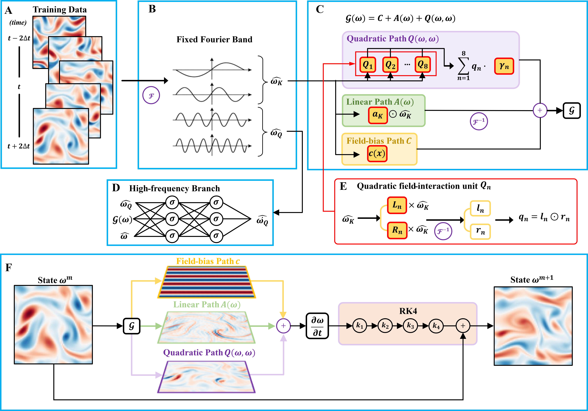

# GIFT

**Generator Identification by Field Tomography**

Learning continuous-time flow dynamics from vorticity-field trajectories, with explicit generator components for prediction and equation-parameter identification.

[English](#english) · [中文](#中文) · [Setup](docs/SETUP.md) · [Experiments](EXPERIMENTS.md) · [Models](https://github.com/ArmstrongInCN/GIFT/releases/tag/current-protocol-20261020-source-free) · [References](#references)

[](docs/ALGORITHM.md)

[](EXPERIMENTS.md)

*Architecture and W1 predictions at t = 5, 6, 7 and 8 for confirmation trajectory 100005. Each image links to its detailed description.*

## English

### Method

GIFT identifies a continuous-time generator from flow-field trajectories. For the vorticity field $\omega$, the true dynamics and the learned generator are written as

$$\frac{\mathrm{d}\omega}{\mathrm{d}t}=G^{\dagger}(\omega),\qquad G(\omega)=C+A(\omega)+Q(\omega,\omega).$$

Field tomography separates the bias, linear and quadratic components through their amplitude responses: $A(\lambda\omega)=\lambda A(\omega)$ and $Q(\lambda\omega,\lambda\omega)=\lambda^2Q(\omega,\omega)$. Learnable spectral filters represent the spatial operators. A high-frequency branch and recursive local correction complete the flow predictor, which advances the state using fourth-order Runge–Kutta integration. With the generator frozen, fitting physical equation terms to its channel outputs yields equation-parameter estimates. See the [algorithm description](docs/ALGORITHM.md).

### Results

The W1/W2 protocol uses 300 training trajectories and 76 observation nodes at intervals of 0.04 seconds; GIFT-Lite uses the first 50 training trajectories. Prediction results below use the 180-trajectory confirmation set.

- **W1 — flow prediction:** GIFT's mean relative L2 error over the 75 future nodes is **2.4687%**, with **3.8113%** at t = 8. GIFT-Lite reaches **3.6608% / 6.5787%**. The comparison includes FNO-2D, FNO-3D, U-NO, U-Net and ANIE.
- **W2 — cross-resolution prediction:** trained at N64, GIFT achieves mean relative L2 errors of **2.1098% / 2.0633% / 2.0610%** over the 25 future nodes at N64 / N96 / N128.
- **W3 — equation-parameter identification:** five methods are evaluated on 50 noise-free parameter combinations, using one trajectory per combination. [Per-case estimates, error summaries and measured costs](EXPERIMENTS.md#43-w350组无噪声方程参数识别) are available.

S1–S3 evaluate the high-frequency branch, recursive local correction and initial-condition distributions. Full results, training recipes and evaluation splits are recorded in [EXPERIMENTS.md](EXPERIMENTS.md).

### Quick start

The reference prediction environment uses Python 3.10.19, PyTorch 2.10.0 and CUDA 12.6. Run these commands from the repository root:

```shell
python -m venv ../gift-env
# Activate ../gift-env using your shell's activation command.
python -m pip install torch==2.10.0 --index-url https://download.pytorch.org/whl/cu126
python -m pip install -r requirements-reproduction.txt
python -m pip install -e .

export GIFT_DATA_ROOT=/absolute/path/GIFT-dataset
export GIFT_EXTERNAL_ROOT=/absolute/path/gift-external
export GIFT_ANIE_SOURCE_ROOT=/absolute/path/gift-external/anie
export GIFT_EXTERNAL_ADAPTER_ROOT=/absolute/path/gift-external-runtime

python -m scripts.verify_data --root "$GIFT_DATA_ROOT"
python -m scripts.prepare_external --root "$GIFT_EXTERNAL_ROOT"
```

Prepare the external methods and runtime interfaces outside GIFT using the [adaptation guide](docs/EXTERNAL_MANUAL_ADAPTATION.md). Source versions are recorded in [external_sources.json](external_sources.json) and [anie_sources.json](anie_sources.json). [SETUP.md](docs/SETUP.md) includes PowerShell commands and the separate PINN environment.

- **Flow prediction:** [W1/W2 training and reference-model evaluation](docs/CURRENT_REPRODUCTION.md).
- **Parameter identification:** [W3 data preparation, training and aggregation](docs/W3_REPRODUCTION.md).

### Data and models

The dataset has been uploaded to ScienceDB. DOI: [10.57760/sciencedb.013lo](https://doi.org/10.57760/sciencedb.013lo). See the [dataset layout](docs/data_package/README.md) and [generation workflow](docs/DATA_GENERATION.md). Set `GIFT_DATA_ROOT` to the dataset directory.

[Download the reference models](https://github.com/ArmstrongInCN/GIFT/releases/download/current-protocol-20261020-source-free/GIFT-current-models-20261020-source-free.zip) for the seven prediction methods and two paired GIFT generators. File hashes are listed in [CURRENT_MODEL_BUNDLE.json](docs/CURRENT_MODEL_BUNDLE.json); activation and evaluation commands are in the [reproduction guide](docs/CURRENT_REPRODUCTION.md#reference-model-bundle).

## 中文

### 方法

GIFT 从涡量场轨迹中识别连续时间生成元，将动力学分解为偏置场、线性和二次非线性三个分量。场层析利用各分量对振幅缩放的不同响应将其分离，空间算子由可学习谱滤波器表示。流场预测采用四阶 Runge–Kutta 积分，结合高频支路与递归局部修正。生成元冻结后，通过物理方程项拟合各通道输出，读出方程参数。详见[算法说明](docs/ALGORITHM.md)。

### 结果

W1/W2 使用 300 条训练轨迹、76 个观测时间点，时间间隔为 0.04 秒；GIFT-Lite 使用前 50 条训练轨迹。以下预测结果来自包含 180 条轨迹的确认集。

- **W1 流场预测：** GIFT 未来 75 点的平均相对 L2 误差为 **2.4687%**，t = 8 时为 **3.8113%**；GIFT-Lite 为 **3.6608%／6.5787%**。对比方法包括 FNO-2D、FNO-3D、U-NO、U-Net 和 ANIE。
- **W2 跨分辨率预测：** GIFT 在 N64 训练，在 N64／N96／N128 上未来 25 点的平均相对 L2 误差分别为 **2.1098%／2.0633%／2.0610%**。
- **W3 方程参数识别：** 在 50 组无噪声参数组合上评估五种方法，每组使用一条轨迹。[实验记录](EXPERIMENTS.md#43-w350组无噪声方程参数识别)列出逐组参数估计、误差汇总与实测成本。

S1–S3 分别考察高频支路、递归局部修正和初值分布。完整结果、训练设置与评估集划分见 [EXPERIMENTS.md](EXPERIMENTS.md)。

### 安装与运行

安装命令见上方 [Quick start](#quick-start)，PowerShell 写法及 PINN 独立环境见[环境配置](docs/SETUP.md)。数据目录由 `GIFT_DATA_ROOT` 指定。外部方法及其运行接口在 GIFT 仓库外准备，固定版本见 [external_sources.json](external_sources.json) 和 [anie_sources.json](anie_sources.json)，具体操作见[适配说明](docs/EXTERNAL_MANUAL_ADAPTATION.md)。

- **流场预测：** [W1/W2 训练与参考模型评估](docs/CURRENT_REPRODUCTION.md)。
- **参数识别：** [W3 数据准备、训练与汇总](docs/W3_REPRODUCTION.md)。

### 数据与模型

数据集已上传至 ScienceDB，DOI：[10.57760/sciencedb.013lo](https://doi.org/10.57760/sciencedb.013lo)。目录与数据生成方法见[数据包说明](docs/data_package/README.md)和[生成流程](docs/DATA_GENERATION.md)。

[参考模型下载](https://github.com/ArmstrongInCN/GIFT/releases/download/current-protocol-20261020-source-free/GIFT-current-models-20261020-source-free.zip)包含七种预测方法及两份配套 GIFT 生成元。[文件清单](docs/CURRENT_MODEL_BUNDLE.json)提供大小与 SHA256，[复现流程](docs/CURRENT_REPRODUCTION.md#reference-model-bundle)提供模型激活和评估命令。

## Documentation / 文档

- [Algorithm / 算法](docs/ALGORITHM.md) — generator structure and field tomography / 生成元结构与场层析。
- [Experiments / 实验](EXPERIMENTS.md) — numerical results and configurations / 数值结果与实验设置。
- [Training / 训练](docs/TRAINING_PROTOCOL.md) — data splits, budgets and checkpoints / 数据划分、训练预算与检查点。
- [Models / 模型](docs/CHECKPOINTS.md) — reference weights and model identities / 参考权重与模型身份。
- [Validation / 验证](docs/VALIDATION.md) — tests and numerical checks / 测试与数值核验。

## References

External implementations and their associated publications / 外部实现与相关文献：

- **FNO-2D / FNO-3D** — [neuraloperator/neuraloperator](https://github.com/neuraloperator/neuraloperator). Li, Z. et al. [Fourier Neural Operator for Parametric Partial Differential Equations](https://arxiv.org/abs/2010.08895). ICLR (2021); Li, Z. et al. [Neural Operator: Graph Kernel Network for Partial Differential Equations](https://arxiv.org/abs/2003.03485). arXiv:2003.03485 (2020).
- **U-NO** — [ashiq24/UNO](https://github.com/ashiq24/UNO). Rahman, M. A., Ross, Z. E. & Azizzadenesheli, K. [U-NO: U-shaped Neural Operators](https://openreview.net/forum?id=j3oQF9coJd). TMLR (2023).
- **U-Net baseline** — [Rui1521/Turbulent-Flow-Nets](https://github.com/Rui1521/Turbulent-Flow-Nets). Wang, R., Kashinath, K., Mustafa, M., Albert, A. & Yu, R. [Towards Physics-informed Deep Learning for Turbulent Flow Prediction](https://arxiv.org/abs/1911.08655). KDD (2020).
- **ANIE** — [emazap7/ANIE](https://github.com/emazap7/ANIE). Zappala, E. et al. [Learning integral operators via neural integral equations](https://doi.org/10.1038/s42256-024-00886-8). Nature Machine Intelligence **6**, 1046–1062 (2024).
- **Galerkin attention used by ANIE** — [scaomath/galerkin-transformer](https://github.com/scaomath/galerkin-transformer). Cao, S. [Choose a Transformer: Fourier or Galerkin](https://openreview.net/forum?id=ssohLcmn4-r). NeurIPS **34**, 24924–24940 (2021).
- **PINN-SR** — [isds-neu/EQDiscovery](https://github.com/isds-neu/EQDiscovery). Chen, Z., Liu, Y. & Sun, H. [Physics-informed learning of governing equations from scarce data](https://doi.org/10.1038/s41467-021-26434-1). Nature Communications **12**, 6136 (2021). Raissi, M., Perdikaris, P. & Karniadakis, G. E. [Physics-informed neural networks: A deep learning framework for solving forward and inverse problems involving nonlinear partial differential equations](https://doi.org/10.1016/j.jcp.2018.10.045). Journal of Computational Physics **378**, 686–707 (2019).
- **PDE-FIND** — [snagcliffs/PDE-FIND](https://github.com/snagcliffs/PDE-FIND). Rudy, S. H., Brunton, S. L., Proctor, J. L. & Kutz, J. N. [Data-driven discovery of partial differential equations](https://doi.org/10.1126/sciadv.1602614). Science Advances **3**, e1602614 (2017).
- **TensorFlow optimizers** — [tensorflow/tensorflow](https://github.com/tensorflow/tensorflow/tree/v1.15.0). Abadi, M. et al. [TensorFlow: Large-scale machine learning on heterogeneous systems](https://www.tensorflow.org/about/bib) (2015).
